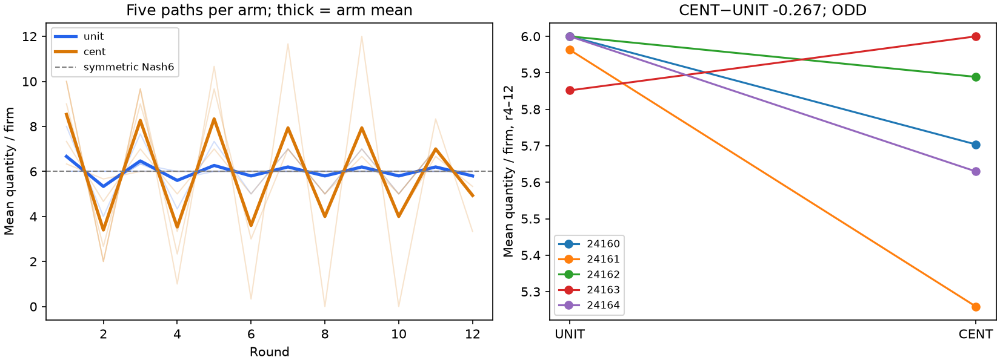

# S06 — denomination invariance (own)

**ODD** for the registered two-sided exploratory screen. Ten fresh games / five time-matched blocks; T12, no messages, exact conditional calculator in both arms. Every monetary display is multiplied by100 in CENT, with explicit conversion; actions and real payoffs are unchanged.

Primary mean quantity/firm r4–12: UNIT **5.963**, CENT **5.696**; CENT−UNIT **-0.267**, descriptive bootstrap95% **[-0.519, -0.022]**, paired t95% **[-0.659, 0.125]**, two-sided sign-flip **p=0.1875**. Zero tuning attempts; no held-out test claim.

Exact block difference numerators /27: [-8, -19, -3, 4, -10]. Separate enumeration of all3125 empirical resamples gives [-0.5185185185185185, -0.022222222222222223]; the registered10000-draw bounds remain the reported estimate.

| Outcome r4–12 | UNIT | CENT | CENT−UNIT [bootstrap95%] | Paired t95% |
|---|---:|---:|---|---|
| quantity | 5.963 | 5.696 | -0.267 [-0.519, -0.022] | [-0.659, 0.125] |
| price | 12.111 | 13.200 | 1.089 [0.089, 2.422] | [-0.778, 2.956] |
| profit | 35.667 | 21.896 | -13.770 [-33.311, -0.956] | [-40.831, 13.290] |
| actual_stage_regret | 1.030 | 25.037 | 24.007 [2.178, 56.074] | [-21.218, 69.233] |
| lag_conditional_regret | 0.000 | 1.407 | 1.407 [0.119, 3.304] | [-1.212, 4.027] |
| distance_nash | 0.230 | 2.052 | 1.822 [-0.067, 3.733] | [-1.016, 4.661] |
| absolute_change | 0.489 | 3.941 | 3.452 [0.163, 7.052] | [-1.950, 8.853] |
| all_equal | 0.933 | 0.644 | -0.289 [-0.556, 0.022] | [-0.753, 0.175] |

All money outcomes above use common currency, so the displayed100x denomination is normalized out. Regrets are individual one-step diagnostics; the conditional table is not a forecast or dynamic optimum. Secondary outcomes cannot promote a hit.

| Block | UNIT primary quantity | CENT primary quantity | Difference |
|---|---:|---:|---:|
| 24160 | 6.000 | 5.704 | -0.296 |
| 24161 | 5.963 | 5.259 | -0.704 |
| 24162 | 6.000 | 5.889 | -0.111 |
| 24163 | 5.852 | 6.000 | 0.148 |
| 24164 | 6.000 | 5.630 | -0.370 |

All-round and final-round descriptive means (no further tests):

| Window | Arm | Quantity | Price | Profit | Change |
|---|---|---:|---:|---:|---:|
| all_rounds | unit | 6.011 | 11.967 | 34.644 | 0.624 |
| all_rounds | cent | 5.956 | 12.350 | 16.983 | 4.133 |
| final | unit | 5.800 | 12.600 | 37.800 | 0.400 |
| final | cent | 4.933 | 15.200 | 43.067 | 2.067 |

Observed secondary dynamics: consecutive quantity change CENT−UNIT is 3.452 [0.163, 7.052], paired t95% [-1.950, 8.853]. All-round mean quantities are UNIT 6.011, CENT 5.956. The figure shows larger CENT swings in this sample; the odd nine-round primary window can mix cycling phases unevenly. These are prespecified descriptive diagnostics, not a second HIT screen, a mechanism label or evidence of sustained profitable restraint.

362 cached responses /360 valid decisions. Extra requests UNIT=0, CENT=2; rejected-output reasons: {'cent': {'reasoning_over_40_words': 2}}. No excluded/replacement game. Last response 2026-10-24T18:50:07.978740+00:00; all logical calls started before cutoff. Complete exact-request replay consumes every key once and checks source registration, exports, actions, tables and payoffs. Independent raw recomputation checks 240 metric/window cells, 24 bootstrap and 8 paired t intervals.

The HIT screen requires |mean|≥1, bootstrap exclusion of0 and two-sided sign p≤.10. With n5 the minimum two-sided p is.0625; HIT reduces to five strictly same-sign differences and |mean|≥1. These are dependent screening conditions, not multiple confirmations or a .05 significance claim. DUD is not equivalence evidence.

Denomination changes numeric magnitude, formatting and the explicit conversion cue together, with no change in real stakes. This does not isolate arithmetic, attention or risk preferences. Common static symmetric Nash remains q6/P12/profit36; coordinated full-market joint output q4 is a benchmark, not a label. No agreement/execution labels, no collusion finding, no sibling headline change.

Tiny sample, short/phase-sensitive games, exploratory pilot selection and shared API interference limit inference. Block IDs time-match games and do not seed action draws. Randomized submission order is not an independent transport-slot assignment; exact sign-flip interpretation assumes exchangeability/symmetric differences. Backend/model labels are client metadata; sampling, tool behavior and OS information isolation are not independently attested. In-flight/internal transport retries are not separately bounded by the logical-call cutoff.

[Design](../DESIGN_S06.md) · [Results](s06_denomination.json) · [Independent check](../logs/s06_independent.json) · [Request audit](../logs/s06_request_audit.json) · [Review dispositions](../logs/s06_review_disposition.md)
