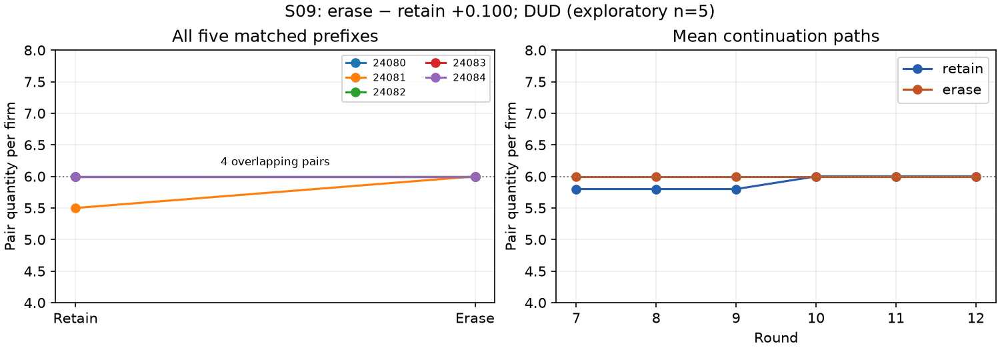

# S09 — erase versus retain earlier private messages

**DUD for the registered quantity-increase screen.** Ten six-round continuations of all five previously observed S07 neutral prefixes; five matched blocks, no tuning.

Primary: pair quantity per firm over rounds7–12, erase minus retain. **+0.100 [+0.000, +0.300]** descriptive block-bootstrap95%; paired t95% [-0.178, +0.378]; upper exact sign-flip p=0.50000.

| Outcome r7–12 | Retain mean | Erase mean | Difference [bootstrap95%] | Paired t95% |
|---|---:|---:|---:|---:|
| quantity | 5.900 | 6.000 | +0.100 [+0.000, +0.300] | [-0.178, +0.378] |
| outsider_quantity | 6.033 | 6.000 | -0.033 [-0.100, +0.000] | [-0.126, +0.059] |
| price | 12.167 | 12.000 | -0.167 [-0.600, +0.100] | [-0.752, +0.419] |
| pair_profit | 36.200 | 36.000 | -0.200 [-1.200, +0.600] | [-1.560, +1.160] |
| outsider_profit | 37.167 | 36.000 | -1.167 [-3.600, +0.100] | [-4.523, +2.189] |
| message_words | 20.550 | 14.383 | -6.167 [-7.267, -4.667] | [-8.237, -4.096] |
| nonempty_messages | 1.000 | 1.000 | +0.000 [+0.000, +0.000] | [+0.000, +0.000] |

| Prefix seed | Retain quantity | Erase quantity | Difference | Round7 difference |
|---|---:|---:|---:|---:|
| 24080 | 6.000 | 6.000 | +0.000 | +0.000 |
| 24081 | 5.500 | 6.000 | +0.500 | +1.000 |
| 24082 | 6.000 | 6.000 | +0.000 | +0.000 |
| 24083 | 6.000 | 6.000 | +0.000 | +0.000 |
| 24084 | 6.000 | 6.000 | +0.000 | +0.000 |

Round7-only pair output: +0.200 [+0.000, +0.600]; seed differences [0.0, 1.0, 0.0, 0.0, 0.0]. Mean absolute round7 arm difference 0.200.
Outsider round7 output difference mean +0.000; seed differences [0.0, 0.0, 0.0, 0.0, 0.0] (descriptive negative control).
Source nonempty message slots: 60/60, over source rounds1–6; per-prefix counts {'24080': 12, '24081': 12, '24082': 12, '24083': 12, '24084': 12}. Exposure is not an agreement label.
Cached responses: 183; retries by arm: {'retain': 3, 'erase': 0}. No failed games.

The initial public history is identical within each block. Messages sent in rounds1–6 are jointly withheld; both arms retain their boxes and receive new messages from round8. Public actions can preserve prior agreements; future messages can rebuild coordination from public history. This estimates the total continuation effect of withholding these transcripts at this fork, including later behavioral feedback, rather than the original channel effect. It cannot separate empty-inbox cues from message semantics.

Scope clarification after final review: round6 messages had not appeared in any source decision prompt and would first be read in round7. Jointly removing rounds1–6 therefore combines loss of previously seen transcript history with blocked incoming information. This is a transcript-visibility intervention, not pure forgetting. New messages can renegotiate from public history, without necessarily recovering arbitrary deleted content. The original registered DESIGN_S09.md is preserved unchanged; this paragraph narrows interpretation without changing the rule or estimates.

Parser retries remain part of the operational contrast (three retain, zero erase); see [retry audit](../logs/s09_retry_audit.json). Separately implemented arithmetic recomputation uses the frozen resampling seed to reproduce the same estimand. A post-review exhaustive empirical-bootstrap check also matches both primary and fork bounds; this validates arithmetic under the same resampling assumptions, not population inference. [Exact check and raw quantity histograms](../logs/s09_exact_check.json). Posthoc raw quantity counts: all-agent erase {'6': 90}; pair erase {'6': 60}; pair retain {'4': 3, '6': 57}. These are posthoc diagnostics, not new hypotheses or exclusions.

Sent-message-length difference is -6.167 words (erase–retain), with 5/5 negative block differences. This descriptive behavior response does not attest erasure isolation or coordination; no secondary HIT is promoted.

Intervals that collapse for constant paired differences describe observed resampling support; they do not establish zero population uncertainty. The outsider has identical round7 prompts across arms, but its separately sampled action can still differ without leakage.

Prefixes were previously observed; no independent-seed replication. With n=5, bootstrap and t intervals are fragile; the sign-flip calculation assumes slot exchangeability/symmetric differences. A DUD screen is not evidence of equivalence or absence of a communication effect. No verified agreement/execution labels or collusion inference. Pair-profit changes are descriptive and are not a HIT gate. Model/backend labels and sampling/isolation limitations are inherited from S07.

Mandatory cache-only full replay, every key consumed once, prefix/source/registration and exports/payoffs checks pass. Independent full metric/statistic check: [audit](../logs/s09_independent.json).

Reproduce: `TMPDIR=/var/tmp uv run python -m sim.replay`; `uv run python scripts/s09_analyze.py`; `uv run python scripts/s09_independent.py`; `uv run python scripts/s09_exact_check.py`; `uv run python scripts/s09_present.py`. After17:48 the generator command is an archived-cache resume, not a fresh replication.

[Registered design](../DESIGN_S09.md) · [Machine-readable results](s09_replay.json)
