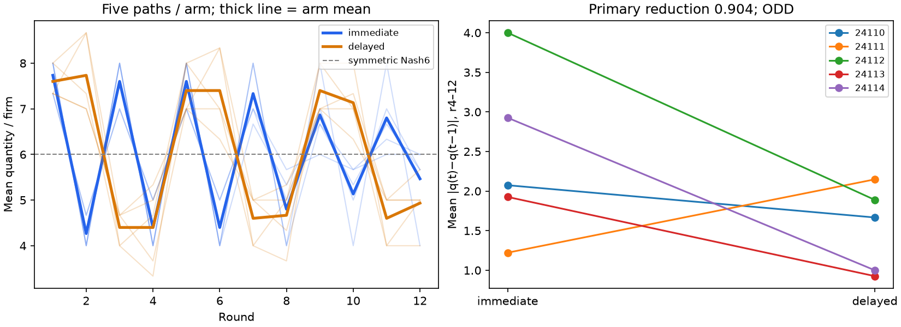

# S11 — delayed market feedback

**ODD** under the frozen consecutive-change screen. Ten fresh games, five time-matched pairs, no messages; zero tuning.

Primary: mean |q(t)−q(t−1)| per firm, rounds4–12. Positive immediate−delayed means slower consecutive changes, not convergence or less collusion.

| Outcome r4–12 | Immediate | Delayed | Contrast | Descriptive bootstrap95% | Paired t95% |
|---|---:|---:|---:|---|---|
| quantity (delayed−immediate) | 5.867 | 5.837 | -0.030 | [-0.148, 0.067] | [-0.206, 0.147] |
| price (delayed−immediate) | 12.400 | 12.489 | 0.089 | [-0.200, 0.467] | [-0.440, 0.618] |
| profit (delayed−immediate) | 32.044 | 31.393 | -0.652 | [-5.444, 3.467] | [-7.741, 6.437] |
| actual_stage_regret (delayed−immediate) | 7.452 | 8.733 | 1.281 | [-5.407, 9.378] | [-10.751, 13.314] |
| lag1_regret (hidden feedback in delayed arm; diagnostic) (delayed−immediate) | 0.304 | 5.030 | 4.726 | [2.148, 7.726] | [0.254, 9.198] |
| distance_nash (delayed−immediate) | 1.259 | 1.348 | 0.089 | [-0.533, 0.830] | [-1.003, 1.180] |
| absolute_change (immediate−delayed) | 2.430 | 1.526 | 0.904 | [-0.089, 1.815] | [-0.630, 2.438] |
| all_equal (delayed−immediate) | 0.711 | 0.711 | 0.000 | [-0.089, 0.089] | [-0.138, 0.138] |

Primary block differences: ['0.407', '-0.926', '2.111', '1.000', '1.926']; exact integer numerators [11, -25, 57, 27, 52]/27. Upper sign-flip p=0.09375; lower p=0.93750.
Independent exact enumeration of all3125 empirical bootstrap resamples: [-0.089, 1.815]. The frozen10000-draw bootstrap remains the reported estimate.

| Block | Immediate change | Delayed change | Immediate quantity | Delayed quantity |
|---|---:|---:|---:|---:|
| 24110 | 2.074 | 1.667 | 5.815 | 5.852 |
| 24111 | 1.222 | 2.148 | 5.963 | 5.704 |
| 24112 | 4.000 | 1.889 | 5.778 | 5.852 |
| 24113 | 1.926 | 0.926 | 5.963 | 5.889 |
| 24114 | 2.926 | 1.000 | 5.815 | 5.889 |

All-round and final-round arm means (descriptive, not additional tests):

| Window | Immediate change | Delayed change | Immediate quantity | Delayed quantity |
|---|---:|---:|---:|---:|
| all_rounds | 2.606 | 1.697 | 6.033 | 6.022 |
| final | 1.333 | 0.333 | 5.467 | 4.933 |

All 366 requests/responses cached; 360 valid decisions; retries by arm {'immediate': 2, 'delayed': 4}. Complete mandatory replay consumes every key once and verifies all exports, payoffs and registered source hashes. Independent checker reproduces 240 metric/window cells, 24 bootstrap intervals and 8 paired t intervals.

All six rejected responses exceeded40 reasoning words (two immediate/four delayed); no game was excluded. [Full attempt audit](../logs/s11_retry_audit.json).

Both arms receive an exact conditional own-profit calculator. Immediate prompts reveal rounds1..t−1; delayed prompts reveal1..t−2, including own feedback. The delayed warmup also lacks a table at round2. This tests a bundled information-timing intervention in stateless agents. It does not isolate a realistic rival-only information lag.

No verified agreement/execution labels. Smoother consecutive output can coexist with persistent cycles; low mean output, high price, common trajectories and individual-profit arithmetic are not collusion labels. Quantity/price/profit and lag1 regret are secondary; lag1 regret is computed even when that feedback is hidden. There is no no-calculator arm and no causal identification of the calculator mechanism. S03 is motivation, not pooled data.

At n5 HIT is equivalent to five strictly positive block differences and mean reduction ≥1; these are not three independent evidential checks. DUD means the directional screen failed, not no effect. Symmetric best response initialized away from Nash can yield slower consecutive changes; this is not a surprising collusion finding. At Nash6 both lags can stay fixed. T12 and the nine-transition primary window cannot establish asymptotic stabilization. n5 is exploratory; bootstrap bounds are descriptive, paired t intervals fragile, and sign-flip validity requires exchangeability/symmetric differences despite possible shared-backend interference. Submission order is randomized within block; firm order is fixed. Block IDs only label time-matched games; they do not seed actions, initial states or API draws. No independently attested model identity, temperature, tool behavior or OS information isolation. Fresh empty directories/read-only requests are verified invocation properties only.

Post-review independent parsing verifies all366 saved request histories,317 actual calculator tables, lag cues and rival summaries without production prompt helpers. The original frozen runner has a collector-delay race on terminal failure; none occurred here. The separate cache-only safe-run wrapper propagates abort from the worker, with two synthetic regressions. Scientific source/result bytes are unchanged. Presentation was revised after outcomes; it is separate from the13-file frozen scientific manifest.

[Design](../DESIGN_S11.md) · [Frozen results](s11_delay.json) · [Independent checks](../logs/s11_independent.json) · [Request audit](../logs/s11_request_audit.json) · [Renderer chronology](../logs/s11_renderer_provenance.json) · [Review dispositions](../logs/s11_review_disposition.md)
