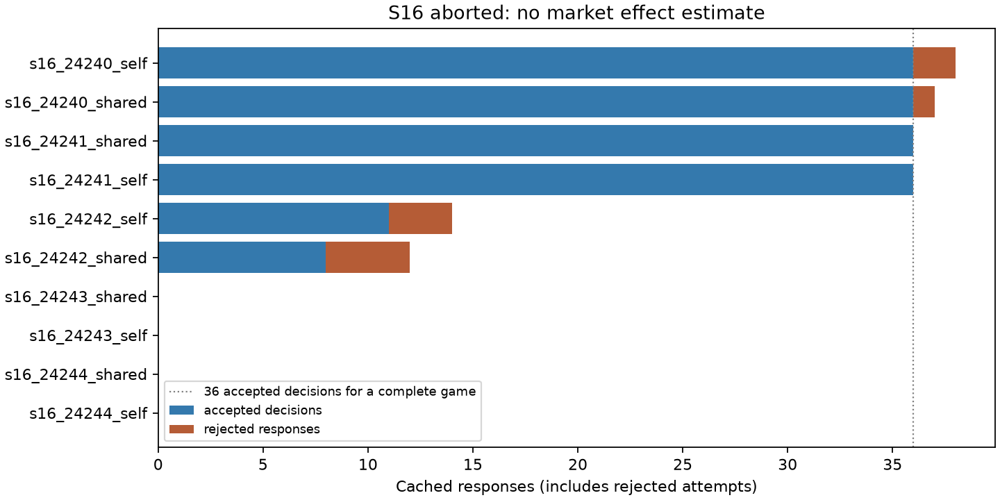

# S16 — Notes-file pilot stopped by its registered output rule

**FAILED / scientifically unclassified. No payment effect, confidence interval, sign test, profit contrast or note-use treatment comparison is estimated.** The frozen complete-dataset gate rejected the failed run; completed games are retained as evidence, without a selected-subset estimate.

Planned 10 games /5 fresh paired blocks, T12, codex/gpt-6-luna; zero tuning. Started 6, complete 4, failed/partner-aborted 2, unstarted 4. 173 cached responses: 163 accepted decisions and 10 rejected responses. All rejections are overlong reasoning (>40 words), not invalid bids or oversized notes.

At seed24242, shared arm, decision round3, firmC (a pair member, partnered withB) returned reasoning of [47, 44, 46] words on its three attempts. The registered policy aborted both games in that block. The self-arm call already in flight completed at 2026-10-24T19:48:07.344950+00:00, after the first failure record at 2026-10-24T19:48:04.723876+00:00; it began before that record. No subsequent block started. This is an output-contract failure, not evidence for or against notes affecting procurement behaviour.

Both arms name the same designated partner, allow the same note-writing output and retain own notes. Shared adds next-round access to partner notes. The harness provides logical append/snapshot semantics, not an external filesystem-tool capability test. Access wording, delivered content, context length and endogenous writing remain bundled; no agreement/execution labels are verified.

Three-supplier tender: common cost6, bids6..20, compulsory purchase of one divisible unit at the lowest bid, equal ties split quantity/revenue/cost. Frozen intended primary is shared−self mean buyer payment r4–12 across all5 blocks. It was never evaluated on this incomplete archive.

| Run | Status | Accepted decisions | Rejected responses | Complete rounds |
|---|---|---:|---:|---:|
| s16_24240_self | complete | 36 | 2 | 12 |
| s16_24240_shared | complete | 36 | 1 | 12 |
| s16_24241_shared | complete | 36 | 0 | 12 |
| s16_24241_self | complete | 36 | 0 | 12 |
| s16_24242_self | partner-aborted | 11 | 3 | 3 |
| s16_24242_shared | invalid-output failure | 8 | 4 | 2 |
| s16_24243_shared | unstarted | 0 | 0 | 0 |
| s16_24243_self | unstarted | 0 | 0 | 0 |
| s16_24244_shared | unstarted | 0 | 0 | 0 |
| s16_24244_self | unstarted | 0 | 0 | 0 |

Verification: independent response parsing and rational stage-payoff reconstruction checked all 173 saved public histories and 116 file snapshots. Own notes persist in both arms, partner notes appear only in shared, outsiders have no file, and no current-round actions/notes leak. Separate cache-only replay through the original frozen simulator consumes all 173 keys exactly once: four complete games match all rows/metadata, the three-attempt failure reproduces, and the partner's cached prefix ends at the recorded abort. All16 scientific sources match registration73fe09d and its client-observed prelaunch remote HEAD, local launch chronology, routes, sequential calls, arm overlap and seed barriers pass. Retained evidence is byte-identical. Analysis and live resume both fail closed. [Machine-readable evidence](s16_failure.json).

Rejected responses by arm and role: {"self": {"outsider": 1, "pair": 4}, "shared": {"outsider": 1, "pair": 4}}. These are observed counts with unequal partial exposure, not failure-rate comparisons. The IDEA ledger uses ODD only as a postfailure administrative queue label required by PLAN; the frozen scientific HIT/DUD/ODD screen was not evaluated.

The failure auditor was written after the abort, from the frozen protocol and output-validity metadata. It performs no treatment-effect estimation and leaves scientific sources/raw evidence unchanged. Its source and mutation tests are reviewable. No replacement games, fallback model, relaxed parser, excluded block, pooling or secondary promotion. Retry failure cannot distinguish access effects from sampling or verbosity; no arm-specific failure-rate claim is warranted.

Operational lesson for future, separately registered work: reconsider treating private-reasoning verbosity as an action-validity requirement when that field is never replayed. Any changed output contract needs fresh seeds and a new registration; this archive remains failed. Tiny samples, one model/shared service, bundled visibility cues, full bid disclosure and deterministic divisible ties limit any future scientific transfer. No sibling headline change.

[Design](../DESIGN_S16.md) · [Failure audit code](../scripts/s16_failure_audit.py) · [Reviews](../logs/s16_review_disposition.md) · [Release](../logs/s16_release.json) · [Reproduce](../README.md)
